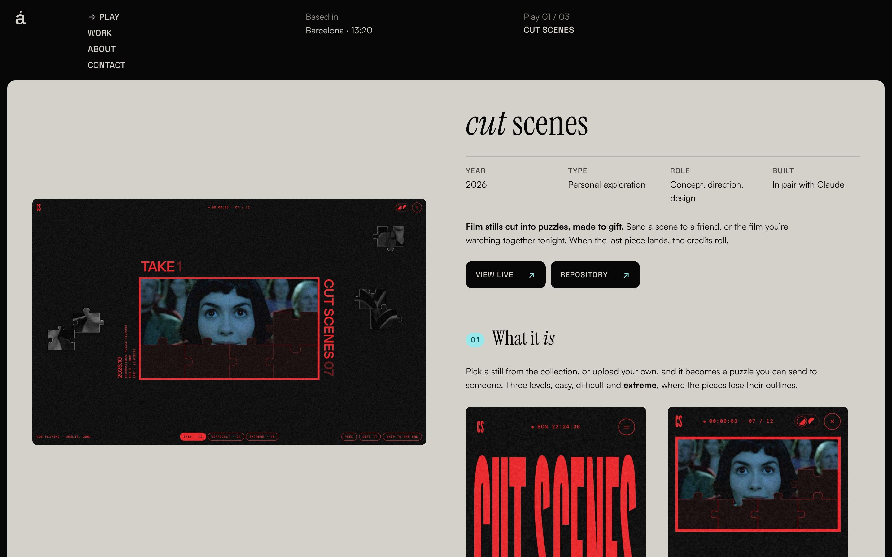
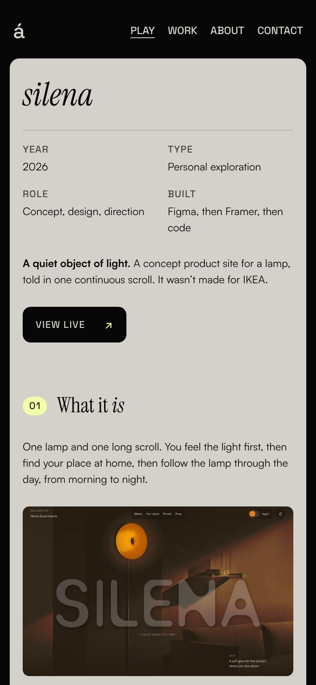
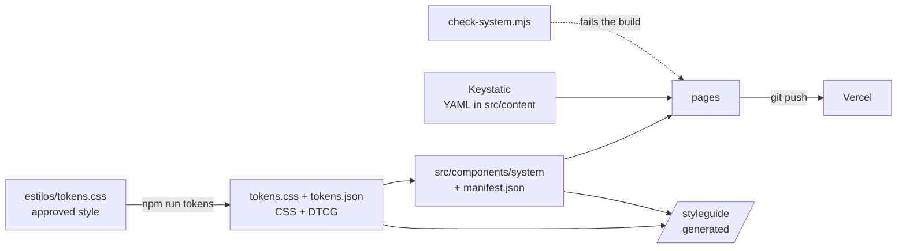

# álida díaz de freijo · portfolio

A designer's portfolio, built like a product: a brief, a design system agents can't skip, and a small team of agents to build it.

**Live:** https://portfolio-alidifreijo.vercel.app

A personal portfolio by Álida Díaz de Freijo, built in pair with Claude.

| Desktop | Mobile |
| --- | --- |
|  |  |

## What it does

- **Play:** the websites Ali designs and builds herself (Cut Scenes, cutouts, Silena), each told in numbered chapters, with a stage that follows the reader.
- **Work:** the companies she has designed with, one row per company. Each case is led by its text: context, role, process and result.
- **About**, **Contact** (a crossword and a chat), **How this portfolio is built**, and a work-in-progress reference library.
- Every case wears the colour of one of six agents (Systems, Research, Creative, Ops, Empathy, Collab).

## How it's built



| Piece | What it does |
| --- | --- |
| [Astro](https://astro.build) | Builds the site; almost every page is static |
| [Keystatic](https://keystatic.com) | Content editor at `/keystatic`; saves YAML to the repo |
| Design tokens | One approved file (`estilos/tokens.css`) generates CSS variables and a [DTCG](https://www.designtokens.org/) JSON |
| `DESIGN.md` + component manifest | The rules in plain words, and what each base component is for |
| `scripts/check-system.mjs` | Runs before every build; fails on any colour, size, font, radius, spacing or shadow that isn't a token, and on blur or gradients |
| `.claude/` | The skills and agents that build and review the site |
| Vercel | Hosting; every branch gets a preview |

```
estilos/                 the approved style (the source of truth)
DESIGN.md                the design system rules, in plain words
src/
  styles/                generated tokens, legacy tokens, recorded debt, base styles
  components/system/     base components + manifest.json
  pages/                 home, about, contact, play/, work/, library, how-this-portfolio-is-built, styleguide
  content/               projects, agents and page texts (edited in Keystatic)
  layouts/Base.astro     header, footer, <head>
scripts/                 tokens, system check, images, video, static preview
public/                  images, videos, fonts, CV
docs/                    maintenance guide (Spanish), case notes, audits
.claude/                 skills (method + portfolio-system) and the reviewer agent
```

## Why it holds

- **Nothing to steal.** No database, no accounts, no forms that store anything, no cookies, no tracking.
- **Strict headers.** A Content-Security-Policy that only allows the site's own files (`script-src 'self'`, no inline scripts, no `eval`), no framing, no sniffing, a closed Permissions-Policy and `Cross-Origin-Opener-Policy`.
- **Everything self-hosted.** Fonts and code ship from the site itself; no CDN can change what it runs.
- **One exception, on purpose:** the content editor at `/keystatic` gets a looser policy (it needs GitHub's API and runs its own inline code). It's documented in `vercel.json` and only applies there.

## Decisions worth explaining

- **A design system agents can't skip.** The build fails if a page uses a value that isn't a token. Old pages carry a recorded debt that can only go down, so the system tightens as pages are rebuilt.
- **The styleguide is generated,** from the tokens and the component manifest, so it can't drift from the code.
- **Videos are never cropped,** always have a poster with content, and only load when they come near the screen. AV1 and lighter phone versions are picked up by name when they exist.
- **No inline scripts.** Every script ships as a file, so the Content-Security-Policy can forbid inline code.
- **No tracking, no data collected** from visitors.

## Run it locally

```bash
npm install
npm run dev            # site on :4321, editor on :4321/keystatic
npm run check          # design system check
npm run build          # check + production build
npm run build:static   # static copy in dist-static/, opens without a server
```

## Credits and license

Code by Álida Díaz de Freijo with Claude. Fonts: Instrument Serif and Space Grotesk (SIL Open Font License, via Fontsource) and Satoshi (Indian Type Foundry, Fontshare licence).

The **code** is MIT licensed (see [LICENSE](LICENSE)). The **images, videos, illustrations, characters and fonts are not**: they are all rights reserved by their owners and may not be reused.
